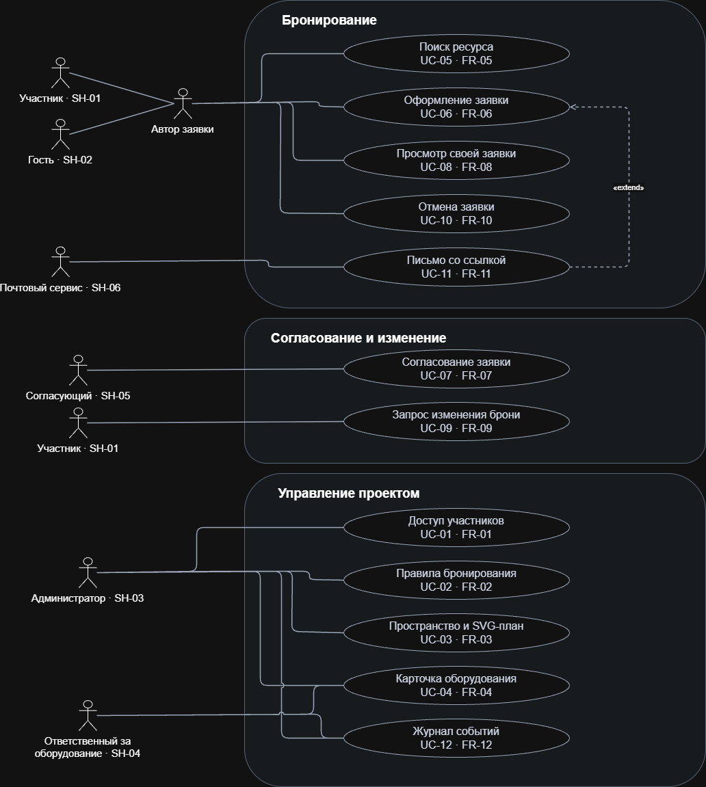

# Лабораторная работа №1. Формулирование требований к программной системе

| Поле | Значение |
|---|---|
| **Студент** | Кушнарев Алексей Александрович|
| **Группа** | РИС-23-3 |
| **Вариант** | Дипломный проект Roomy - система управления и бронирования ресурсов |
| **Постановка задачи** | [README проекта](../../README.md#постановка-задачи)|
| **Репозиторий** | [escaleksey/Roomy](https://github.com/escaleksey/Roomy) |
| **Срок сдачи** | 06.12.2026 |

**Тема.** Анализ предметной области и формулирование требований к программной системе.

**Цель работы.** Научиться анализировать поставленную задачу, выделять заинтересованных лиц, формулировать функциональные и нефункциональные требования и представлять их на диаграмме вариантов использования.

## Краткое описание системы

Roomy - веб-платформа для организаций, которым нужно управлять помещениями и оборудованием в нескольких независимых проектах. Участники и допущенные гости могут проверить доступность ресурсов и оформить одну заявку на помещение, оборудование или их комплект. Администраторы ведут планы, правила и доступ, а ответственные сотрудники актуализируют сведения об оборудовании и рассматривают заявки в пределах своих полномочий. Единый учёт ресурсов, их состояния и занятости позволяет предотвращать двойные брони и восстанавливать историю решений.

## Оглавление

1. [Стейкхолдеры](#1-перечень-заинтересованных-лиц-стейкхолдеров)
2. [Функциональные требования](#2-перечень-функциональных-требований)
3. [Диаграмма вариантов использования](#3-диаграмма-вариантов-использования)
4. [Нефункциональные требования](#4-перечень-нефункциональных-требований)
5. [Предположения](#5-перечень-сделанных-предположений)

## 1. Перечень заинтересованных лиц (стейкхолдеров)

Сотрудник офиса и преподаватель работают в Roomy как участники проекта. Их права зависят от настроек проекта. Внешний клиент бронирует опубликованные ресурсы, а почтовый сервис доставляет ему ссылку на заявку.

| ID | Стейкхолдер | Роль | Интересы / цели | Влияние |
|---|---|---|---|---|
| SH-01 | Участник проекта | Бронирует ресурсы для своей работы или занятий | Найти подходящий комплект на один интервал и видеть статус своих заявок | Среднее - регулярно использует поиск и бронирование, определяет требования к основному сценарию |
| SH-02 | Внешний клиент | Бронирует опубликованные ресурсы в гостевом режиме | Оформить заявку без регистрации и открыть её по ссылке из письма | Среднее - опыт гостя определяет требования к публичному сценарию |
| SH-03 | Администратор проекта | Ведёт пространство, роли и политику бронирования | Поддерживать актуальный план и управлять правами и лимитами проекта | Высокое - принимает решения о правилах и доступе |
| SH-04 | Ответственный за оборудование | Ведёт карточки и изменения оборудования | Знать местоположение техники и исключать неисправные позиции из новых заявок | Среднее - регулярно обновляет данные, от которых зависит доступность |
| SH-05 | Согласующий | Рассматривает назначенные заявки | Видеть состав и цель заявки и своевременно фиксировать решение | Высокое - его решение определяет судьбу заявок с обязательным согласованием |
| SH-06 | Поставщик почтового сервиса | Внешний технический участник, принимает письма к отправке | Принимать корректно адресованные сообщения и соблюдать согласованные ограничения доставки | Среднее - доступность сервиса влияет на получение гостевой ссылки |

## 2. Перечень функциональных требований

**Must** — функции, необходимые для работы первой версии, включая гостевое бронирование. **Should** — изменение действующей брони с повторной проверкой и, при необходимости, согласованием.

| ID | Требование | Стейкхолдер | Приоритет (MoSCoW) | Обоснование |
|---|---|---|---|---|
| FR-01 | Система должна позволять администратору настраивать доступ участников к выбранному проекту через локальные роли с разрешениями. Роли, назначенные в одном проекте, действуют только в нём. | SH-03 | Must | Полномочия пользователей различаются между проектами. |
| FR-02 | Система должна позволять администратору настраивать правила проекта, включая разрешённые роли и ресурсы, гостевой режим и публикацию ресурсов, максимальную длительность, горизонт бронирования, лимит активных заявок, срок согласования и условия отмены. | SH-03, SH-05 | Must | Правила различаются между проектами и определяют допустимость заявки. |
| FR-03 | Система должна позволять администратору вести иерархию «здание - этаж - помещение» с интерактивным SVG-планом этажа, на котором размеченные области связаны с карточками помещений и их характеристиками. | SH-03 | Must | Пользователь получает актуальный план с привязкой к реальным помещениям. |
| FR-04 | Система должна позволять уполномоченному сотруднику вести карточку стационарного или переносного оборудования с состоянием, этажом, координатами и необязательной привязкой к помещению. При переводе в недоступное состояние затронутые позиции будущих заявок помечаются, а карточка сохраняется. | SH-03, SH-04 | Must | Изменение состояния или места хранения влияет на возможность использовать оборудование. |
| FR-05 | Система должна показывать доступность видимых пользователю помещений и оборудования за выбранный интервал в списке и на плане. Список поддерживает поиск по названию и фильтры по типу, расположению и характеристикам. Гость видит опубликованные ресурсы проекта с включённым гостевым режимом. | SH-01, SH-02 | Must | Пользователи находят подходящий вариант до подачи заявки. |
| FR-06 | Система должна оформлять одну заявку на один или несколько ресурсов одного проекта на общем интервале `[начало, конец)`. При сохранении проверяются права, правила, состояние и пересечения по всем позициям. При успехе комплект сохраняется атомарно со статусом «подтверждена» или «ожидает подтверждения» и блокирует интервал. При отказе система показывает причину, бронь не создаётся. Для гостевой заявки требуются опубликованные ресурсы и адрес электронной почты. | SH-01, SH-02, SH-03 | Must | Единая операция исключает двойную и частичную бронь. |
| FR-07 | Система должна позволять назначенному согласующему подтвердить заявку или отклонить её с указанием причины. При нескольких обязательных согласующих заявка подтверждается после всех положительных решений. Первый отказ или истечение срока ожидания освобождает весь комплект. | SH-05, SH-01, SH-02 | Must | Итог согласования управляет доступностью всех позиций. |
| FR-08 | Система должна показывать автору его заявку с составом ресурсов, интервалом, текущим статусом и доступной ему причиной отказа. Гость открывает страницу по ссылке с токеном, в том числе после завершения брони. | SH-01, SH-02 | Must | Автор может проверить результат без обращения к администратору. |
| FR-09 | Система должна позволять участнику запросить изменение интервала или состава своей подтверждённой брони, в том числе заменить недоступную позицию. Изменение повторно проверяется, а при обязательном согласовании прежняя бронь действует до принятия новых условий. | SH-01, SH-05 | Should | Можно изменить заявку и сохранить действующую бронь до решения. |
| FR-10 | Система должна позволять автору отменить свою заявку в пределах правил проекта. При успешной отмене одновременно освобождаются все позиции заявки. | SH-01, SH-02 | Must | Отмена возвращает ресурсы в доступный фонд. |
| FR-11 | Система должна передавать внешнему почтовому сервису письмо на указанный гостем адрес после сохранения гостевой заявки. В письме содержится ссылка с токеном на страницу этой заявки. | SH-02, SH-06 | Must | Ссылка нужна для самостоятельного просмотра статуса и отмены без регистрации. |
| FR-12 | Система должна предоставлять уполномоченным сотрудникам журнал событий проекта с переходами статусов заявок и изменениями состояния и размещения ресурсов. Запись содержит действие, время, объект, предыдущее и новое значение и инициатора, если он известен. | SH-03, SH-04 | Must | По журналу можно восстановить ход действий при споре или сбое. |

### Как Roomy учитывает помещение и оборудование

Эти правила действуют при просмотре доступности (FR-05) и оформлении заявки (FR-06).

- Если помещение занято, переносное оборудование внутри него нельзя отдельно забронировать на пересекающееся время.
- Если связанное оборудование уже забронировано отдельно, Roomy предупреждает об этом при выборе помещения.

## 3. Диаграмма вариантов использования

На диаграмме показаны бронирование, согласование и управление проектом. У каждого варианта использования указан ID соответствующего требования. «Автор заявки» объединяет действия участника и гостя. Гостю доступны опубликованные ресурсы, а письмо со ссылкой отправляется при создании гостевой заявки.

[Редактируемый исходник draw.io](./use-case.drawio)

### Описание ключевого сценария

| Поле | Значение |
|---|---|
| **Use Case** | UC-06 [FR-06] Оформить заявку |
| **Актор** | Участник проекта или внешний клиент при включённом гостевом режиме |
| **Предусловие** | Пользователь открыл проект. Предварительно выбранные ресурсы доступны ему для просмотра, у гостя есть адрес электронной почты. |
| **Постусловие** | Roomy сохранила одну заявку на весь комплект и заблокировала выбранный интервал для каждой позиции. |

**Основной поток**

1. Пользователь задаёт начало и конец брони, выбирает ресурсы и указывает цель. Гость также вводит адрес электронной почты.
2. При сохранении Roomy проверяет права, правила проекта, состояние ресурсов и пересечения с другими заявками.
3. Roomy сохраняет все позиции одной операцией. При обязательном согласовании заявка получает статус «ожидает подтверждения», в остальных случаях — «подтверждена».
4. Если заявку оформил гость, Roomy запускает отправку письма со ссылкой (UC-11).

**Альтернативный поток**

Если одна из позиций недоступна, нарушено правило или ресурс уже заняла другая заявка, Roomy отклоняет весь комплект и объясняет причину. Пользователь может изменить время или состав и отправить заявку повторно.

## 4. Перечень нефункциональных требований

Численные значения в таблице — предложенные критерии для учебного стенда. Их предстоит согласовать перед приёмкой.

| ID | Категория | Требование | Метрика / критерий приёмки | Почему выбрано |
|---|---|---|---|---|
| NFR-01 | Безопасность | Roomy должна изолировать данные проектов и защищать гостевые ссылки и сетевое взаимодействие. | 0 успешных запросов в проверках доступа к чужому проекту и к чужой заявке по токену. 100% пользовательских API-запросов проходят через HTTPS. | Один пользователь может иметь разные полномочия в нескольких проектах. |
| NFR-02 | Согласованность | При конкурентных операциях Roomy должна сохранять корректную занятость ресурсов. | В 100 прогонах с 10 одновременными допустимыми заявками на один свободный ресурс и одинаковый интервал создаётся ровно 1 блокирующая заявка. В 100 проверках с занятой позицией комплекта сохраняется 0 позиций отклонённых заявок. | Двойная или частичная бронь срывает использование ресурса. |
| NFR-03 | Производительность | Поиск доступных ресурсов должен обеспечивать быстрый отклик при целевой нагрузке. | p95 серверного времени ответа на поиск по названию, фильтрам и интервалу ≤ 500 мс в течение 10 минут при 20 запросах в секунду и 1 000 ресурсах в одном проекте. | Поиск повторяется при изменении интервала или состава заявки. |
| NFR-04 | Восстанавливаемость | Данные Roomy должны восстанавливаться из резервной копии. | При учебном восстановлении точка восстановления отстаёт от момента сбоя не более чем на 24 часа (RPO), а сервис возвращается к работе не более чем за 4 часа (RTO). После восстановления проверяются заявки, их позиции и история. | Потеря расписания и журнала затрудняет работу нескольких проектов одновременно. |
| NFR-05 | Наблюдаемость | Ошибки обработки запросов и отправки гостевой почты должны быть доступны для диагностики через журналы и трассировки OpenTelemetry. | В 10 из 10 тестов с отказом почтового сервиса по идентификатору заявки можно найти связанный запрос, фоновую задачу и запись об ошибке в течение 1 минуты после её возникновения. | Фоновый сбой может помешать гостю получить ссылку уже после сохранения заявки. |

## 5. Перечень сделанных предположений

Допущения уточняют открытые параметры дипломного проекта, включая нагрузку стенда, сроки и работу почтового сервиса.

| ID | Предположение | Влияние на требования |
|---|---|---|
| A-01 | Учебный стенд моделирует проект с 1 000 активных ресурсов. Для 10-минутного замера при 20 запросах поиска в секунду принят целевой p95 в 500 мс. | Определяет параметры проверки NFR-03. |
| A-02 | На учебном стенде допустима потеря изменений за период до 24 часов и восстановление до 4 часов. | Задаёт RPO и RTO для NFR-04. |
| A-03 | В пилотной конфигурации срок ожидания согласования можно задать от 15 минут до 24 часов, если согласование включено. Для проекта со включённым согласованием задаётся конечный срок. | Уточняет допустимые настройки FR-02 и момент перехода в статус «истекла» в FR-07. |
| A-04 | Гостевые письма передаются через внешний почтовый сервис. При временном сбое почты уже сохранённая заявка удерживает ресурсы по правилам проекта, а неотправленное письмо остаётся доступным для повторной обработки. | Задаёт внешнего актора SH-06, границу FR-11 и проверку NFR-05. |
| A-05 | Порог в 1 минуту для появления диагностики и число прогонов в проверках согласованности и наблюдаемости приняты для учебного стенда. | Устанавливает воспроизводимые условия проверки NFR-02 и NFR-05. |

